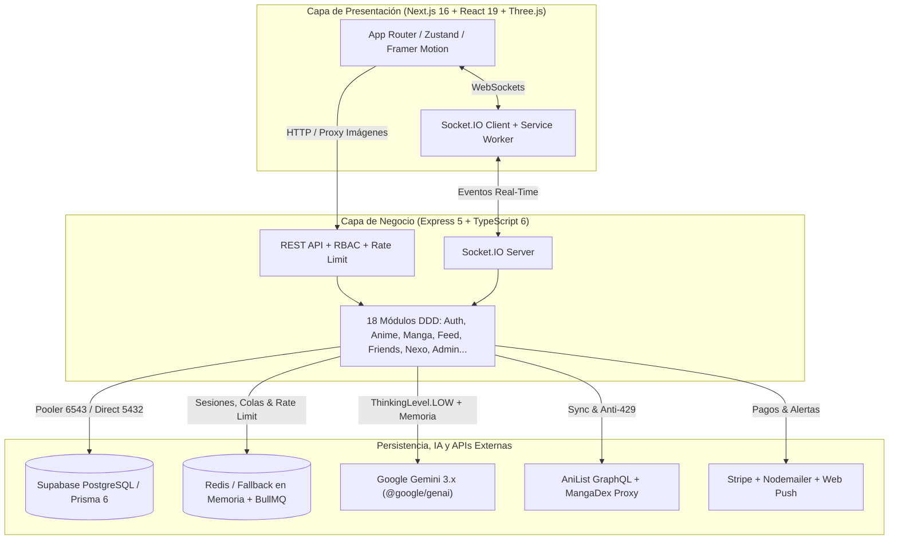

# 🌌 AniNexo — La Dimensión Social del Anime y Manga

> **AniNexo** es una plataforma híbrida que combina una **Enciclopedia y Lector de Anime/Manga**, una **Red Social en Tiempo Real** y un **Asistente Cognitivo de IA llamado Nexo** impulsado por **Google Gemini 3.x** (`@google/genai`), todo sobre **Next.js 16**, **Express 5**, **Prisma 6** y **Supabase PostgreSQL**.

Diseñada con una estética *Dark-Premium* espacial con acentos en cian (`#00E5FF`) y escenas 3D interactivas, la plataforma integra comunidad, recomendaciones inteligentes, mensajería instantánea y gestión de colecciones en un mismo ecosistema.

---

## ✨ Nuevas Tecnologías y Actualizaciones Recientes

| Área | Tecnología / Cambio | Detalle Técnico |
|---|---|---|
| **IA Cognitiva Real (Nexo AI)** | **Google Gemini 3.x (`@google/genai ^3.2.0`)** | Migración completa al SDK oficial `@google/genai` sin simulaciones ni mocks. Usa `gemini-3.5-flash-lite` (estándar) y `gemini-3.5-flash` (Premium) con `ThinkingLevel.LOW` y cascada automática real (`3.6-flash`, `3.7-flash`, `3.8-flash`) ante saturación (`503`/`504`) o cambios de disponibilidad. |
| **Base de Datos Cloud** | **Supabase PostgreSQL + Transaction Pooler** | Migración de MySQL a PostgreSQL en Supabase usando conexión Pooler (`pgbouncer=true`, puerto `6543`) para consultas de runtime y conexión directa (puerto `5432`) para migraciones de Prisma. |
| **Frontend Next-Gen** | **Next.js `16.2.6` + Turbopack + React `19.2.4`** | App Router con `viewTransition` experimental, compilación ultrarrápida con Turbopack y renderizado híbrido SSR/CSR. |
| **Gráficos 3D y Visual Novel UI** | **Three.js `^0.184.0` + React Three Fiber `^9.6.1`** | Fondos y orbes 3D (`@react-three/drei`), animaciones con **Framer Motion `^12.41.0`** y tour interactivo estilo novela visual con **React Joyride `^3.1.0`**. |
| **Proxy de Manga e Imágenes** | **MangaDex + Proxy Backend (`/api/manga/image-proxy`)** | Helper `imageProxy.ts` en frontend y proxy en Express para servir portadas y páginas de capítulos saltando restricciones de hotlinking/CORS, además de backoff ante `429` de AniList. |
| **Ecosistema Social Completo** | **Comunidad, Historias 24h, Guardados y Nexos Diarios** | Nuevas rutas `/dashboard/community`, `/dashboard/daily`, `/dashboard/saved`, `/about`, visor interactivo de historias, gestión real de solicitudes de amistad, chats en burbuja y sincronización real con `/api/auth/me`. |

---

## 🛠️ Stack Tecnológico Detallado

### 🎨 Frontend (`client/`)
* **Framework Core:** Next.js `16.2.6` (App Router, Turbopack, `viewTransition`), React `19.2.4`, React DOM `19.2.4`, TypeScript `^5`.
* **Gráficos 3D y Movimiento:** Three.js `^0.184.0`, `@react-three/fiber` `^9.6.1`, `@react-three/drei` `^10.7.7`, Framer Motion `^12.41.0`.
* **Estado Global y Datos:** Zustand `^5.0.13`, Fetch API con sincronización JWT/Cookies y WebSockets.
* **Visualización e Interfaz:** Recharts `^3.8.1` (analíticas y estadísticas), React Joyride `^3.1.0` (Nexo Tour guiado), Lucide React `^1.14.0`, React Icons `^5.6.0`, CSS Modules + Styled JSX.
* **Tiempo Real y PWA:** `socket.io-client` `^4.8.3`, Service Worker (`sw.js`) y soporte de notificaciones Web Push.

### ⚙️ Backend (`server/`)
* **Runtime y API:** Node.js, **Express `^5.2.1`**, **TypeScript `^6.0.3`**, `ts-node`, `nodemon`.
* **ORM y Base de Datos:** **Prisma `^6.19.3`** (`@prisma/client`), driver **`pg` `^8.21.0`** conectado a **Supabase PostgreSQL**.
* **Inteligencia Artificial:** **`@google/genai` `^3.2.0`** (familia **Gemini 3.x** con memoria persistente `NexoMemory`, contexto de catálogo real e historial multi-turno) y cliente **`openai` `^6.37.0`** opcional.
* **Tiempo Real, Colas y Caché:** **Socket.IO `^4.8.3`**, `@socket.io/redis-adapter` `^8.3.0`, **IORedis `^5.10.1`** (con fallback automático en memoria para entorno local sin Redis), **BullMQ `^5.76.6`**, `node-cron` `^4.2.1`.
* **Pagos, Correo y Notificaciones:** **Stripe `^22.1.1`** (suscripciones Premium), **Nodemailer `^8.0.7`** (correos de verificación y logs), **Web Push `^3.6.7`**.
* **Seguridad, Autenticación y Logs:** `jsonwebtoken` `^9.0.3`, `bcryptjs` `^3.0.3`, **Passport.js** (`passport ^0.7.0`, `passport-google-oauth20 ^2.0.0`), **Helmet `^8.1.0`**, `cors`, `cookie-parser`, `express-session`, `express-rate-limit` `^8.5.1`, **Winston `^3.19.0`**, `morgan`.

### 🌐 APIs Externas e Infraestructura Cloud
* **Supabase:** Base de datos PostgreSQL gestionada + Connection Pooler + credenciales de API/Storage.
* **Google Gemini Developer API:** Generación cognitiva real para Nexo AI (`gemini-3.5-flash-lite` / `gemini-3.5-flash` y respaldo `3.6`/`3.7`/`3.8`).
* **AniList GraphQL API:** Catálogo de animes, temporadas, rankings, personajes y seiyuus con caché en PostgreSQL y reintentos inteligentes anti-rate-limit.
* **MangaDex API:** Búsqueda, fichas de manga, capítulos y lectura optimizada a través del proxy interno de imágenes.

---

## 🚀 Módulos y Funcionalidades Principales

1. **Enciclopedia Anime & Lector Manga (`/dashboard/anime`, `/dashboard/manga`, `/rankings`, `/dashboard/explore`):**
   * Catálogo conectado a AniList y MangaDex con filtros avanzados, lector de capítulos, progreso de lectura y guardado de favoritos.
2. **Nexo AI (`/dashboard` y Orbe Flotante):**
   * Asistente conversacional real conectado a Gemini 3.x con lectura del catálogo en PostgreSQL, lista personal del usuario, medallas y memorias guardadas (`NexoMemory`), diferenciando respuestas estándar y análisis extendidos Premium.
3. **Red Social y Comunidad (`/dashboard/community`, `/dashboard/chat`, `/dashboard/groups`, `/dashboard/profile`):**
   * Publicaciones con menciones de anime, likes polimórficos, comentarios, elementos guardados (`/dashboard/saved`), historias efímeras de 24h con visor modal, grupos temáticos, solicitudes de amistad y chat privado/grupal en tiempo real por WebSockets.
4. **Identidad Otaku (ADN Nexo) y Gamificación (`/register`, `/dashboard/daily`):**
   * Wizard de onboarding de 6 pasos para definir arquetipo y color de tema, rachas y recompensas diarias (**Nexos Diarios**) y sistema automático de insignias/logros.
5. **Administración, Pagos y Moderación (`/admin`, `/dashboard/premium`, `/dashboard/manual`, `/about`):**
   * Métricas en vivo (`AnalyticsSnapshot`), gestión de reportes/advertencias/baneos/apelaciones, suscripciones con Stripe y centro de ayuda/manual del sistema.

---

## 📐 Arquitectura del Sistema



---

## 📂 Estructura del Monorrepósito

```text
AniNexo/
├── client/                         # Frontend Next.js 16 (puerto 3000)
│   ├── public/                     # Assets estáticos, íconos y sw.js
│   ├── src/
│   │   ├── app/                    # Rutas: (auth), about, admin, auth-callback, rankings, settings
│   │   │   └── dashboard/          # anime, chat, community, daily, explore, groups, manga, manual, notifications, premium, profile, saved, search, settings
│   │   ├── components/             # UI 3D, NexoChat, FloatingChat, OnboardingWizard, VerticalStoryRow, TopNavbar...
│   │   └── lib/                    # anilist.ts, imageProxy.ts, animations.ts, hooks/, validators/
│   └── package.json
│
├── server/                         # Backend Express 5 + TypeScript 6 (puerto 3001)
│   ├── prisma/
│   │   └── schema.prisma           # Esquema PostgreSQL (User, Anime, Post, NexoMemory, Badge, Message...)
│   ├── src/
│   │   ├── index.ts                # Entrada principal Express + CORS + Helmet + Rate Limit
│   │   ├── sockets.ts              # Eventos Socket.IO en tiempo real
│   │   ├── lib/                    # prisma, redis, emailService, socketService, workers, logger
│   │   ├── middleware/             # JWT auth, RBAC, sanitización, validadores
│   │   └── modules/                # admin, anime, auth, feed, friends, groups, list, mail, manga, messaging, moderation, nexo, notification, premium, profile, search, social, user
│   └── package.json
│
├── docs/                           # Documentación técnica complementaria
└── README.md
```

---

## ⚙️ Guía de Instalación y Arranque Local

### Prerrequisitos
* **Node.js** `v20` o superior
* Cuenta o instancia de **PostgreSQL / Supabase**
* **API Key de Google Gemini** (AI Studio) para habilitar **Nexo AI**
* *(Opcional)* **Redis** para colas BullMQ y adaptador multi-instancia (si no está definido `REDIS_URL`, el backend activa automáticamente un fallback en memoria)

### 1. Clonar el repositorio
```bash
git clone https://github.com/Eccy405/AniNexo.git
cd AniNexo
```

### 2. Configurar variables de entorno
Crea `server/.env` a partir de la plantilla `server/.env.example`:
```bash
cp server/.env.example server/.env
```
Completa en `server/.env`:
* `DATABASE_URL` (Pooler de Supabase puerto `6543` con `?pgbouncer=true`) y `DIRECT_URL` (puerto `5432` para Prisma).
* `SUPABASE_URL`, `SUPABASE_ANON_KEY`, `SUPABASE_SERVICE_ROLE_KEY`.
* `JWT_SECRET` y `SESSION_SECRET`.
* `GEMINI_API_KEY`, `GEMINI_MODEL="gemini-3.5-flash-lite"`, `GEMINI_PREMIUM_MODEL="gemini-3.5-flash"`.

*(Si configuras variables públicas en frontend, duplica también `client/.env.example` hacia `client/.env.local`.)*

### 3. Instalar dependencias y sincronizar Prisma
```bash
cd server
npm install
npx prisma generate
npx prisma db push
```

### 4. Iniciar Backend y Frontend
En una terminal (`server/` — puerto `3001`):
```bash
cd server
npm run dev
```

En otra terminal (`client/` — puerto `3000`):
```bash
cd client
npm install
npm run dev
```

---

## 🔒 Seguridad Implementada

* **Protección de Secretos:** `.gitignore` excluye `*.env` y `*.env.local` para evitar la exposición de claves de Supabase, JWT o Gemini.
* **JWT + RBAC + Rate Limiting:** Tokens firmados con rotación/blacklist, control de acceso por rol (`USER`, `MODERATOR`, `ADMIN`, `SUPERADMIN`) y limitadores por usuario/IP.
* **Endurecimiento HTTP:** Cabeceras seguras con `Helmet 8`, CORS configurado, cookies `HttpOnly` / `SameSite` y consultas parametrizadas mediante **Prisma ORM**.

---

## 📝 Licencia

Este proyecto se distribuye bajo la licencia **MIT**.
